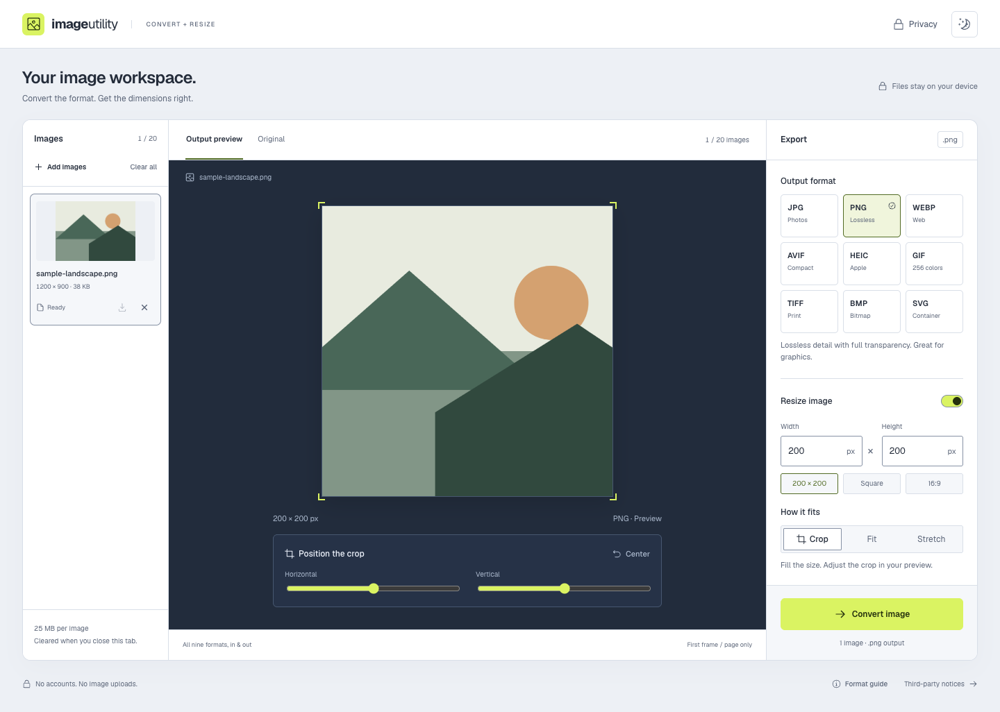

# Image Utility

A public image conversion and resizing workspace. Change formats, adjust dimensions, and prepare a batch for download—all in your browser, with no account or image uploads.

## A workspace for your images

- **Convert between nine formats:** JPG, PNG, WebP, AVIF, HEIC, GIF, TIFF, BMP, and SVG.
- **Resize to exact dimensions:** crop to fill, fit with padding, or stretch to the requested size.
- **Fine-tune each image:** switch between thumbnails, compare the original with the output preview, and adjust individual crop positions.
- **Work in batches:** apply shared export settings and download images individually or together as a ZIP.
- **Control the result:** choose compression quality, preserve supported transparency, or select a background color.
- **Bring files your way:** choose files, drag and drop, paste from the clipboard, or explore with a sample image.
- **Choose your appearance:** light and dark themes that remember your choice, with responsive layouts for desktop and smaller screens.

## Privacy

Selected images are processed on your device. Image data is not uploaded or saved in application storage, and no account is required.

Only your light or dark appearance preference is remembered between visits.

Removing an image, clearing the batch, or closing the tab releases the application's image references. Re-encoding removes original camera and location metadata. Downloaded files remain under your control.

## Format behavior

| Format      | Result                                                                                           |
| ----------- | ------------------------------------------------------------------------------------------------ |
| GIF         | The first frame becomes a still image. GIF output uses up to 256 colors.                         |
| TIFF        | The first page is converted. TIFF output contains one page.                                      |
| HEIC        | The primary image is used.                                                                       |
| SVG         | Input is rendered as an image. Output contains an embedded PNG rather than traced vector shapes. |
| JPG and BMP | Transparency is replaced with the selected background color.                                     |

The workspace displays relevant format notices before conversion.

## Processing limits

| Limit             | Maximum       |
| ----------------- | ------------- |
| Images per batch  | 20            |
| Input file size   | 25 MB         |
| Output resolution | 16 megapixels |

Each image is processed in sequence. Conversion can be cancelled, and completed results remain available when another file fails.
